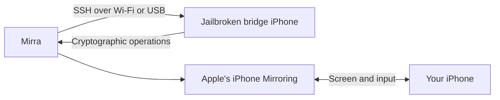

<div align="center">


# Mirra

**Your iPhone. On your Hackintosh.**

A native macOS companion for Apple's iPhone Mirroring on Hackintosh.

[Get started](#get-started) · [Compatibility](#compatibility) · [Screenshots](#screenshots) · [Build](#build-from-source) · [Documentation](#documentation)

**Experimental · Intel macOS**

<p>
  <a href="https://ko-fi.com/eiyuumiru"></a>
</p>


</div>

Mirra prepares a separate jailbroken iPhone as a bridge and keeps its connection
available in the background. Apple's iPhone Mirroring app provides the screen,
keyboard, pointer and authentication. **The iPhone you mirror does not need a
jailbreak.**

## Fork Updates — Standalone Mirra / No Secondary iPhone

> **Research proposal — not implemented.** This fork investigates making Apple's native iPhone Mirroring work on an Intel Hackintosh **without a second jailbroken iPhone**. Upstream Mirra still requires its jailbreak bridge; standalone operation is not yet verified.

Planned experiments: native macOS AppleKeyStore as a local endpoint; one-time pairing and session persistence; a Go/Rust software AKS backend (optionally Alpine/Docker); minimum virtual SEP interfaces; and mapping trust checks on both macOS and stock iOS. AWDL and VideoToolbox compatibility are tracked separately. Software signatures or a fake DCRT do **not** automatically establish trusted Apple device identity.

**[Read the complete Fork Updates roadmap](docs/Fork-Updates.md)** — hypotheses, source files, experimental order, failure criteria and success definition.

**[Standalone architecture audit](docs/Standalone-Audit.md)** — recursive repository analysis and verified blockers. The experimental [local endpoint probe](research/standalone/local_endpoint.py) checks transport only; it does not provide Apple attestation or working Mirroring.

---

## Experimental status

Mirra is an independent community project and is not affiliated with Apple.

Mirra is experimental and provides a best-effort compatibility workaround. It
adapts macOS software interfaces and delegates selected cryptographic operations
to the bridge. It does not recreate a complete T2 chip or provide equivalent hardware
security guarantees. It may not work on your devices even when the listed
requirements are met. Compatibility, features and performance depend on devices,
software, drivers and network conditions. Updates may break functionality.

## Features

- Guided bridge setup with verified SSH access and automatic certificate preparation.
- Background support with recovery after bridge connection failures.
- Connection checks before opening iPhone Mirroring.
- Native error dialogs with optional logs.
- System, Light and Dark appearance options.
- Dated logs with seven-day retention and an **Open log folder** action.

## How it works



The bridge and the iPhone you mirror are separate devices. Apple's account,
pairing and authentication requirements still apply.

## Get started

1. Get the app DMG from [Releases](https://github.com/eiyuumiru/Mirra/releases)
   or the maintainer.
2. Open the DMG, drag **Mirra.app** onto **Applications**, then eject the image.
3. Open Mirra and set up a separate jailbroken bridge with OpenSSH and `ldid`.
   Choose Wi-Fi SSH or select the bridge's USB device and SSH port.
4. Verify the SSH fingerprint and authorize access when prompted.
5. Choose **Prepare connection**, then **Finish setup**.
6. Keep the iPhone you want to mirror locked and nearby with Wi-Fi and Bluetooth
   enabled. Choose **Connect** and complete Apple's authentication.

The app includes Python and its helpers. For macOS security prompts and update
instructions, see [Installation](docs/Installation.md).

Settings contains bridge setup, service controls, appearance options and logs.
Your saved setup survives app updates. Closing the Mirra window leaves background
support running. See the [app guide](docs/App.md) for details.

## Compatibility

Mirra uses private macOS interfaces and currently accepts the following host
and app versions. Unsupported host builds are rejected by the compatibility check.

| Component | Requirement |
| --- | --- |
| Host | Intel `x86_64`, macOS 26.7.2 (`25G332`) |
| Apple app | iPhone Mirroring 1.6 (`98.5`) |
| Bridge | Compatible jailbroken iPhone with OpenSSH and `ldid`; see [Bridge compatibility](docs/Bridges.md) |
| Target iPhone | Meets [Apple's iPhone Mirroring requirements](https://support.apple.com/en-us/120421) |
| Wi-Fi | Working AWDL support |
| Video | Working H.264 VideoToolbox decoding |

Hackintosh hosts are outside Apple's officially supported configuration.
Bridge compatibility depends on the device, jailbreak and available system APIs.
Display quality and performance depend on the network and decoder; full-resolution
rendering is not guaranteed. See [Media](docs/Media.md) and [Decoder](docs/Decoder.md)
for technical details.

## Screenshots

| Home | Settings |
| --- | --- |
|  |  |

| Spotify | YouTube |
| --- | --- |
|  |  |

## Build from source

Use Python 3.9 or later, Apple's Command Line Tools and SDKs with the required
framework stubs. See [Building](docs/Build.md) for requirements and checks.

```sh
make app
```

The app is available at `build/Mirra.app`. To create the DMG:

```sh
make package
```

The build downloads a pinned Python runtime and includes its upstream notices.
Packaging produces `Mirra-v<version>.dmg` with an Applications shortcut.
GitHub's **Source code** downloads provide the source for each tagged release.

## Troubleshooting

| Problem | What to check |
| --- | --- |
| Waiting for the bridge | Jailbreak, SSH access and the selected Wi-Fi address or USB device |
| iPhone not found | Target lock state, proximity, Wi-Fi, Bluetooth and Apple Account |
| Bridge ready but Mirroring fails | Apple's connection error and logs from the same attempt |
| Blank or interrupted video | Wi-Fi/AWDL, decoder logs and [decoder compatibility](docs/Decoder.md) |
| Duplicate Launchpad entries | Keep one installed app and archive development copies |

For a bug report, include your configuration and relevant logs as described in
[Contributing](CONTRIBUTING.md).

## Documentation

| Guide | Contents |
| --- | --- |
| [App](docs/App.md) · [Installation](docs/Installation.md) | Setup, connection, settings and updates |
| [Bridges](docs/Bridges.md) · [Configuration](docs/Configuration.md) | Device requirements and connection profiles |
| [Connection checks](docs/Preflight.md) | Bridge readiness and connection errors |
| [Decoder](docs/Decoder.md) · [Media](docs/Media.md) | Video and transport compatibility |
| [Architecture](docs/Architecture.md) · [Service](docs/Service.md) | Components and background support |
| [Build](docs/Build.md) · [Distribution](docs/Distribution.md) | Building, tests and packages |
| [Release](docs/Release.md) · [Screenshots](docs/Screenshots.md) | Release preparation and demo images |
| [Publishing](docs/Publishing.md) · [Roadmap](docs/Roadmap.md) | Distribution considerations and testing priorities |

## Support the project

If Mirra is useful to you, support its development on [Ko-fi](https://ko-fi.com/eiyuumiru).

## Contributing

Read [CONTRIBUTING.md](CONTRIBUTING.md) for bug reports and development guidance.
For security issues, follow [SECURITY.md](SECURITY.md).

## License and acknowledgments

Mirra's original source and artwork use the [MIT License](LICENSE).

[MtkWireless](https://github.com/Dino-VN/MtkWireless) and the
[HighDelay NVIDIA driver](https://github.com/HighDelay/nvidia-macos-driver/releases)
are external projects with their own installation instructions and terms.
Apple's application and system frameworks remain Apple's property. Bundled
Python components retain their upstream licenses; see [NOTICE.md](NOTICE.md).
